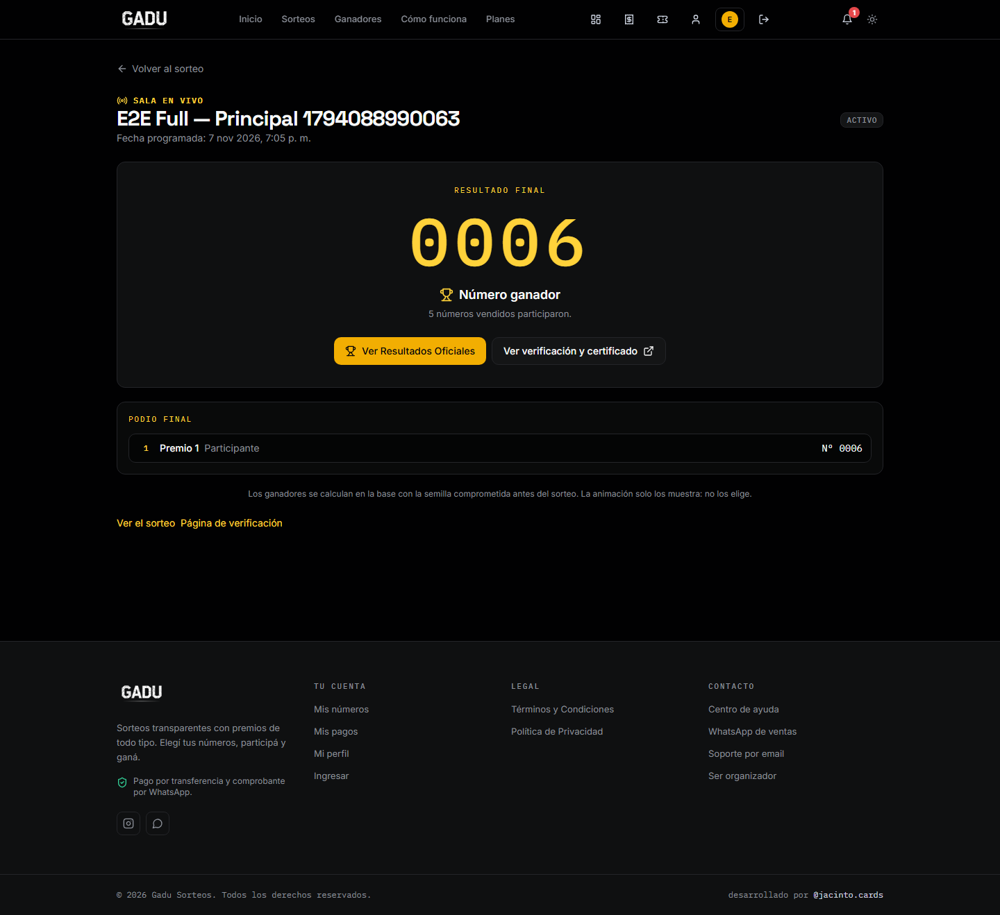
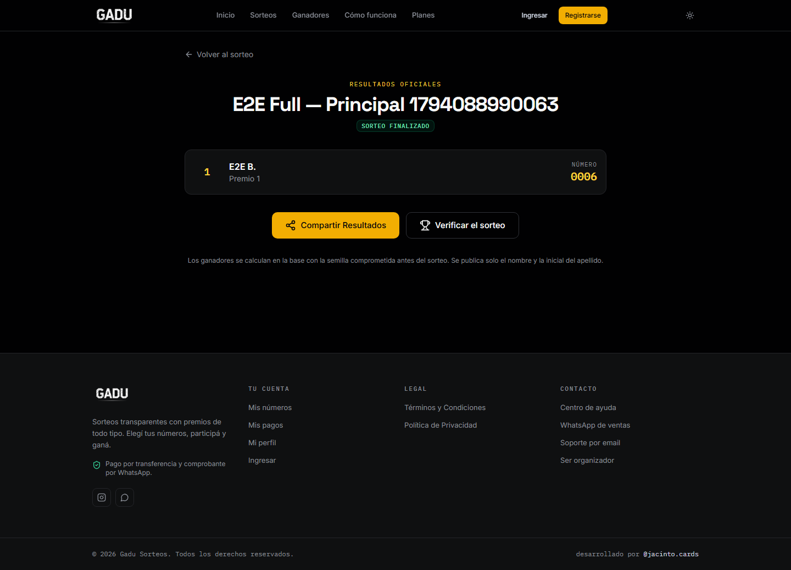
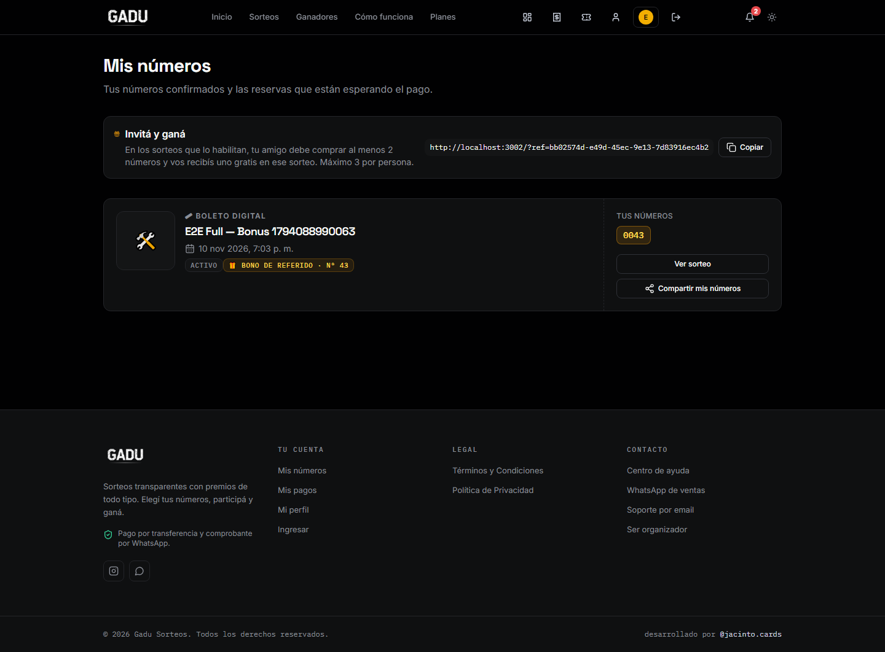
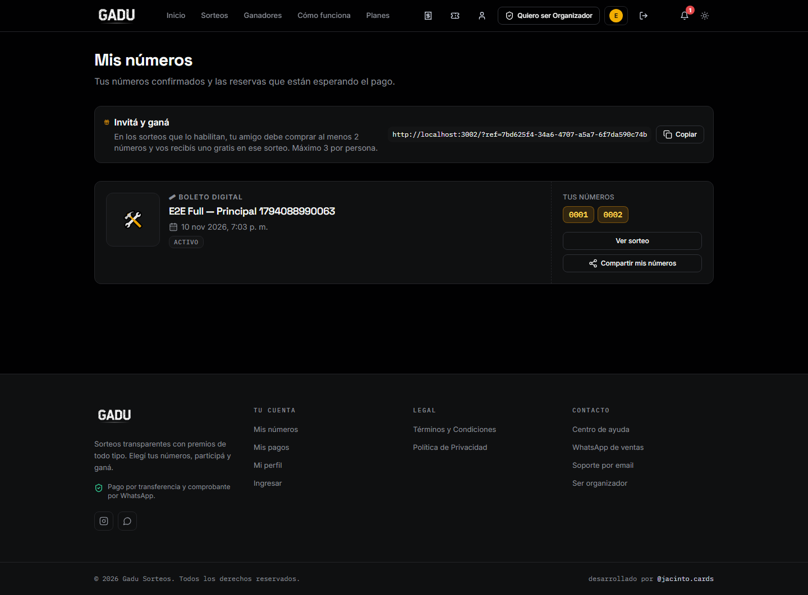
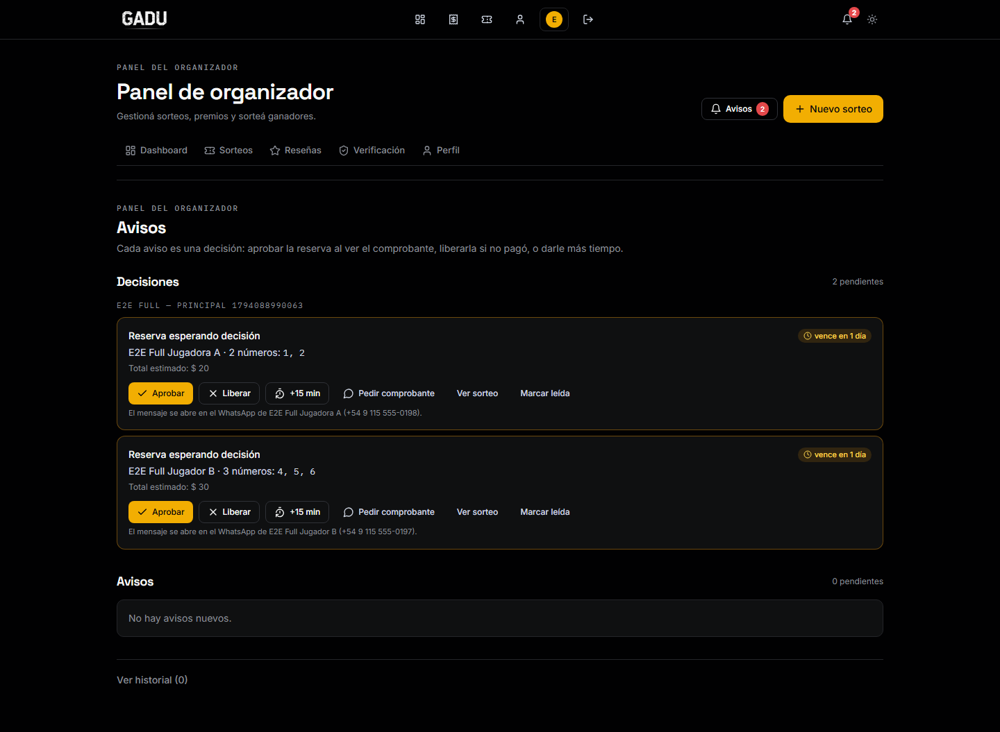

# Escenario F — Full E2E sobre staging

Fecha: 2026-11-07 · Entorno: Supabase `dolxvoxyespguvixhkku` · App: build de producción aislado en `http://localhost:3002`
Escenario: `node runner.mjs F` · Evidencia: esta carpeta (`pasos.json`, `hashes.json`, `capturas/`)

## Veredicto

**19 pasos: 13 `ok` / 6 `falla`.** El flujo completo se ejecutó de punta a punta, pero no termina en verde: hay dos defectos de producto y una discrepancia de expectativa sobre el premio de referidos.

| Fase | Resultado | Qué pasó |
|---|---|---|
| Preparación (`session.mjs`, cuentas, staging) | ✅ PASÓ | 3 cuentas sintéticas; app y bundles con ref de staging; 0 refs de producción; migración 0119. |
| Fase 1 — organizador crea bonus + principal (3 premios) + «Invitá y Ganá» + compromiso | ⚠️ PARCIAL | 3 premios y compromiso ✅. El wizard **no persistió** `referral_enabled/min/max/bonus` (F3 ❌); se configuró desde `/editar` (F3b ✅). |
| Fase 2 — Jugador A entra con `?ref=` y compra 2 números con prepago | ✅ PASÓ | `ReferralCapture` creó el vínculo (sin fallback) y los 2 números quedaron `reserved` con hold de 48 h. |
| Fase 3 — organizador aprueba desde `/admin/notificaciones` y se verifica el número 🎁 | ⚠️ PARCIAL | Aprobación, venta, notificaciones y premio ✅. El número 🎁 **lo recibe el organizador (referente)**, no el Jugador A (F7b ❌). |
| Fase 4 — sorteo en `/sorteos/[slug]/en-vivo` con el botón «Iniciar sorteo» | ⚠️ PARCIAL | El sorteo se ejecuta y la animación funciona ✅. Se generan **0** filas en `raffle_winners`; el podio de 3 premios no existe (F8b ❌). |
| Fase 5 — `/resultados`, animación y hashes | ❌ FALLÓ | Resultados muestra **1** tarjeta, no el podio de 3 (F9a ❌). Huellas del ganador único ✅ 4/4; huellas multipremio ❌ (F9b). Verificador multipremio no aparece (F9c ❌). Consola: **0 errores** ✅ (F10). |

## Hallazgos

### F-01 · El wizard de alta no guarda «Invitá y Ganá»

- El paso 3 muestra los campos (`#referral_enabled`, mínimo, tope, sorteo bonus), pero el `INSERT` de `app/admin/sorteos/nuevo/page.tsx` no incluye esas columnas.
- Resultado observado: `referral_enabled=false`, `referral_min_numbers=1`, `referral_max_per_user=0`, `bonus_raffle_id=null`.
- La pantalla `/admin/sorteos/[id]/editar` sí los guarda (`updateRaffle`), y con eso se pudo continuar (F3b `ok`).
- **Impacto:** el organizador cree que activó el beneficio al crear y no queda activo. Es un P1 de la fase 1.
- Evidencia: `F3-principal.json`, `F03-premios.png`, `F3b-referidos.json`, `F03b-referidos-editados.png`.

### F-02 · El número 🎁 va al referente, no al invitado

- Regla real (0102/0105): `reward_referral` acredita el número al **referente**. El Jugador A entró con el enlace del organizador, así que el premio (Nº **43** del sorteo bonus) quedó para el organizador.
- Verificado en base: `referrals.rewarded=true`, `rewarded_number=43`, `raffle_numbers.origin='premio'`, `sold_to=organizador`. Notificación `buyer_referral_reward` al organizador; A recibió `buyer_reservation_approved`.
- Si la expectativa era que **A** recibiera el número, el producto no lo hace: es una decisión de negocio, no un bug de ejecución. Si se confirma que A debe recibirlo, hay que cambiar la RPC y la UI.
- Evidencia: `F7a-aprobacion-A.json`, `F7b-receptor.json`, `F07-mis-numeros-organizador.png` (bono Nº 43), `F07-mis-numeros-A.png` (A sin bono).

### F-03 · El sorteo en vivo ignora el modo multipremio

- `LiveDrawAnimation.startDraw()` llama `execute_transparent_draw`; esa RPC delega en `draw_winner` (un solo ganador) y **no** en `draw_winner_multi`, aunque `winners_count=3`.
- Observado: `status=drawn`, `winner_number=6`, `raffle_winners=[]`, `results_hash=null`.
- `/resultados` cae al fallback de un ganador: 1 tarjeta («Premio 1 · Nº 0006»).
- El camino correcto ya existe en el server action `drawWinner` (`app/admin/sorteos/[id]/actions.ts`): usa `draw_winner_multi` cuando `winners_count > 1`. El botón de `/en-vivo` no lo usa.
- **Impacto:** cualquier sorteo con más de un premio sortea un solo ganador desde la sala en vivo y no publica podio ni hashes multipremio.
- Evidencia: `F8-sorteo.json`, `F8b-podio.json`, `F08-live-final.png`, `F09-resultados.png`.

### F-04 · Huellas: el ganador único es consistente; el multipremio no existe

| Chequeo | Resultado |
|---|---|
| `commitment` recalculado | ✅ coincide |
| `numbers_hash` (1,2,4,5,6) | ✅ coincide |
| ganador único 6 / `result_hash` | ✅ coincide |
| 3 ganadores esperados (6, 2, 4) en `raffle_winners` | ❌ 0 filas |
| `results_hash` multipremio | ❌ `null` en base; el recalculado no tiene contra qué comparar |
| Doble verificación independiente (`node:crypto`, `verify-hash.mjs`) | ✅ para single / ❌ para multi |

No es un problema de fórmula: `verificarMulti` produce 6, 2 y 4 y un `results_hash`; la base simplemente no guardó ese resultado porque el botón usó el motor de un ganador.

## Capturas

### Live TV — animación y resultado final

- `F08-live-antes.png`: sala con «Iniciar sorteo».
- `F08-live-girando.png`: animación de mezcla.
- `F08-live-final.png`: resultado final. El podio muestra **solo «Premio 1»**.

### Página de resultados

### Quién recibe el bono de referido

### Notificaciones de la aprobación

## Entorno y seguridad

- Staging confirmado: `https://dolxvoxyespguvixhkku.supabase.co`; migración 0119.
- Bundles del cliente: 17 chunks, 2 con ref de staging, **0** con ref de producción (`mjgcoeikcyzwojbqtuah`). Producción no se tocó.
- El servidor se levantó en **3002**, con un build de producción en una copia aislada (`%TEMP%\gadu-e2e-f-3002`) y `node_modules` en junction. El 3001 se dejó libre para no chocar con la otra sesión.
- La primera corrida contra `next dev` murió por heap OOM al compilar `/admin/notificaciones`; el build aislado eliminó esa variable. La corrida final terminó en 3 min 40 s.
- Única intervención de laboratorio declarada: `draw_date` se movió al pasado **después** del compromiso (el motor exige fecha cumplida; `auto_draw=false`).
- Los datos de la corrida quedan **solo en staging**: principal sorteado con 5 vendidos, bonus activo con el Nº 43, cuentas `@gadu.test`.

## Qué corregir (no se tocó código de producción)

1. **F-01:** persistir `referral_enabled`, `referral_min_numbers`, `referral_max_per_user` y `bonus_raffle_id` en el `INSERT` del wizard (o reutilizar `updateRaffle` después del alta).
2. **F-03:** en `LiveDrawAnimation.startDraw`, usar `draw_winner_multi` cuando `winners_count > 1` (o llamar al server action `drawWinner`), y notificar a todos los ganadores. Agregar una prueba E2E que exija 3 filas en `raffle_winners` y `results_hash` no nulo.
3. **F-02:** decidir explícitamente si el 🎁 es para el referente (comportamiento actual) o para el invitado. Documentarlo en la landing y en «Invitá y Ganá».
4. **F-01/F-03:** tests de regresión en `lib/` y en `runner.mjs F`; hoy el escenario deja 6 fallas reproducibles.

## Evidencia

- `pasos.json` — 19 filas con esperado/observado, tiempos y archivos.
- `hashes.json` — recálculo independiente y comparación.
- `resultado-f.json` — salida completa del runner.
- `capturas/` — 18 pantallas.
- `F7a-aprobacion-A.json`, `F8-sorteo.json`, `F9b-hashes.json` — datos crudos.
